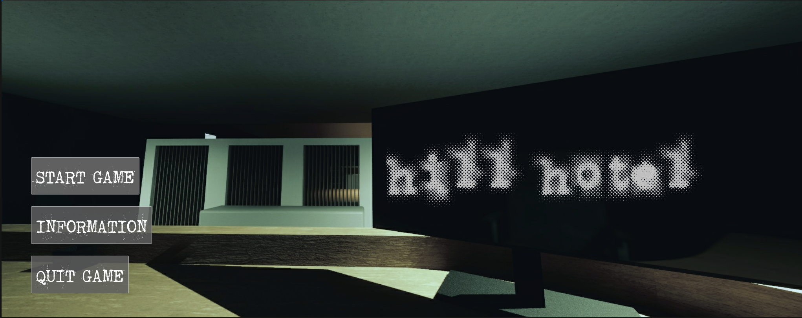
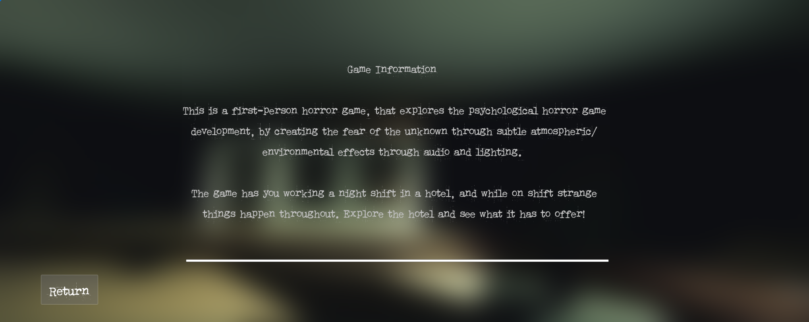
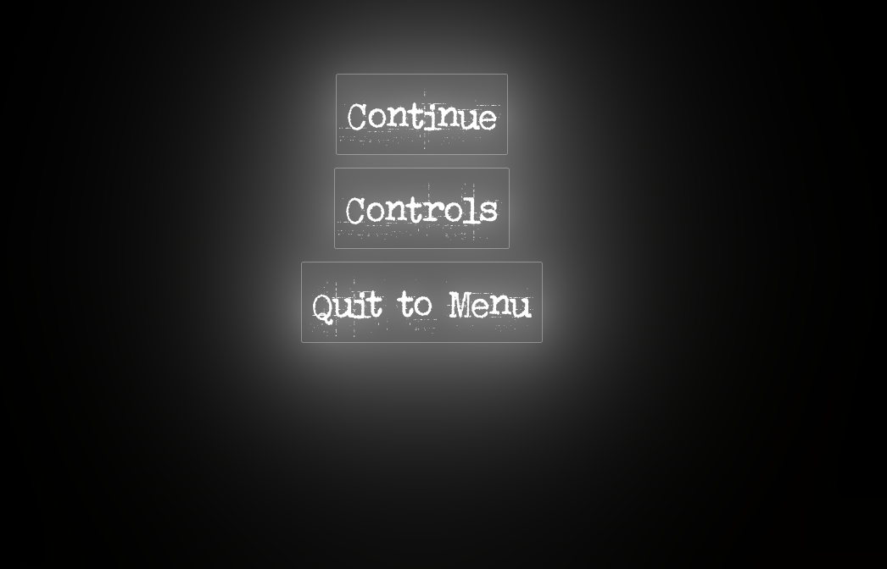
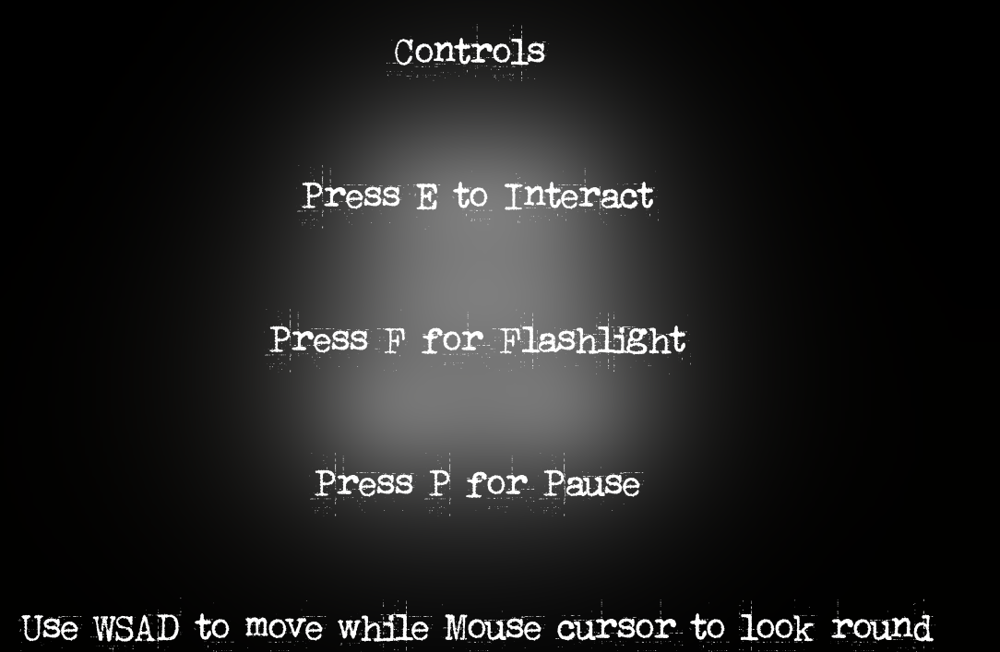
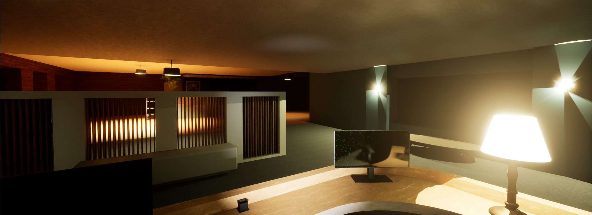
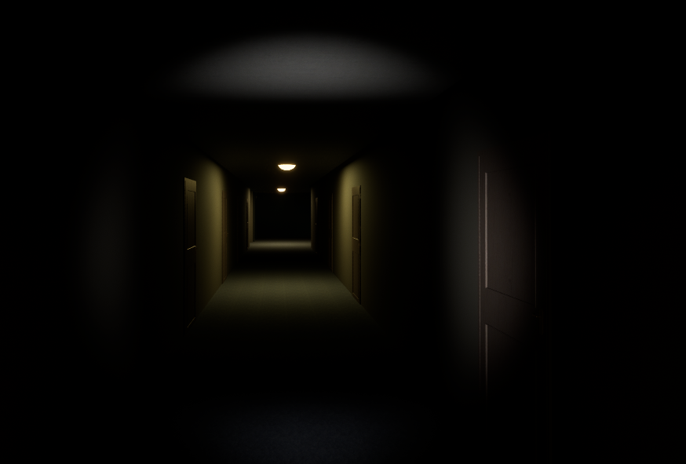
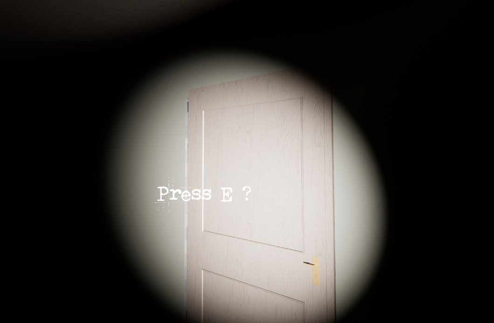

# Unreal Engine 5 – Horror Game Prototype

**University Dissertation Project | Unreal Engine 5 | Blueprint Visual Scripting**

## Project Overview

This project was developed as part of my final-year project for the BSc (Hons) Computing (Games Programming) degree at Edge Hill University.
The project explored how atmosphere, environmental storytelling, lighting and audio design can be used to create tension and fear within a psychological horror experience without relying on combat or jump-scares or enemies coming at the player.
The game prototype was developed alongside a dissertation investigating horror game design and player immersion.
The combined final-year project and dissertation achieved a mark of 77%.

The game is designed to be a first-person horror game, where the player is working there first shift, that being a nightshift at a hotel. and during the nightshift strange/creepy things happen such as sounds, lighting effects, things moving, all small details that can build tension of fear for the player. 

---

## Project Status

This project is an academic prototype and remains unfinished.
The aim of this repository is to showcase the development work, design approach and technical systems implemented during the project.

---

## Features Implemented

- Interactive door systems
- Trigger-based gameplay events
- Atmospheric lighting
- Audio triggers and sound effects
- User interface development
- Level design and world building

---

## Technologies Used

- Unreal Engine 5
- Blueprints
- Unreal Audio Systems
- UI Systems
- Level Design Tools

---

## Skills Demonstrated

- Unreal Engine Development
- Blueprint Scripting
- Game Design
- Problem Solving
- Project Planning
- Research and Documentation

---

## Screenshots

### Main Menu UI

*Screenshot of the games main menu UI, which showcases 3 buttons to either play the game, read the info on it or quit the game. When in the UI view of this a background soundtrack is playing.*

### Information Tab on Main Menu

*Screenshot of the information page on the main menu UI, which explains the games premise and purpose.*

### In-game pause menu 

*Screenshot of the in-game pause menu which is initiated by the player by pressing the 'P' key on the keyboard.*

### In-game pause menu control tab

*Screenshot of the controls page within the pause UI which explains the controls for the player.*

### In-game start point

*Screenshot of the starting point for the player when the start into the game, which positions them behind the reception desk starting their shift.*

### In-game corridor

*Screenshot of one of the hotel's corridors showing what the games atmosphere is like for the horror aspect.*

### Interactive door

*Screenshot of one of the interactive doors where the player can open and enter the room, once they enter they are teleported to a different part of the hotel.*

---

## Gameplay Demonstration

The following video showcases the current state of the Unreal Engine prototype.

---

## Author

Dylan Dwyer

Games Programming Graduate

LinkedIn:
www.linkedin.com/in/dylan-john-dwyer
